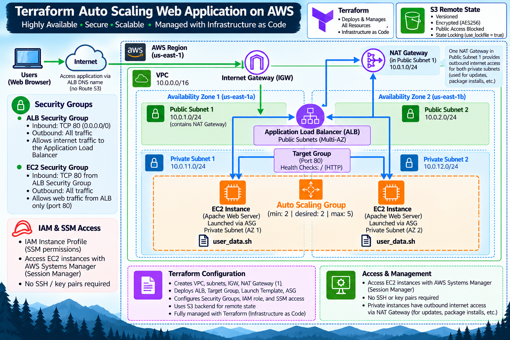
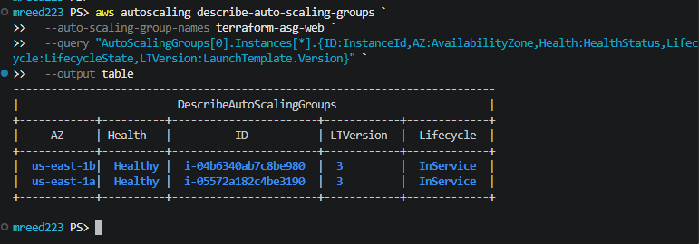
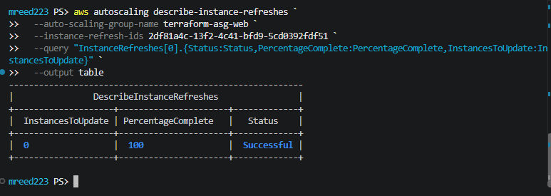
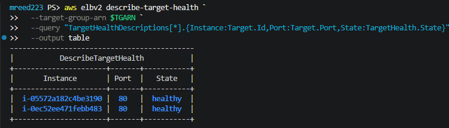
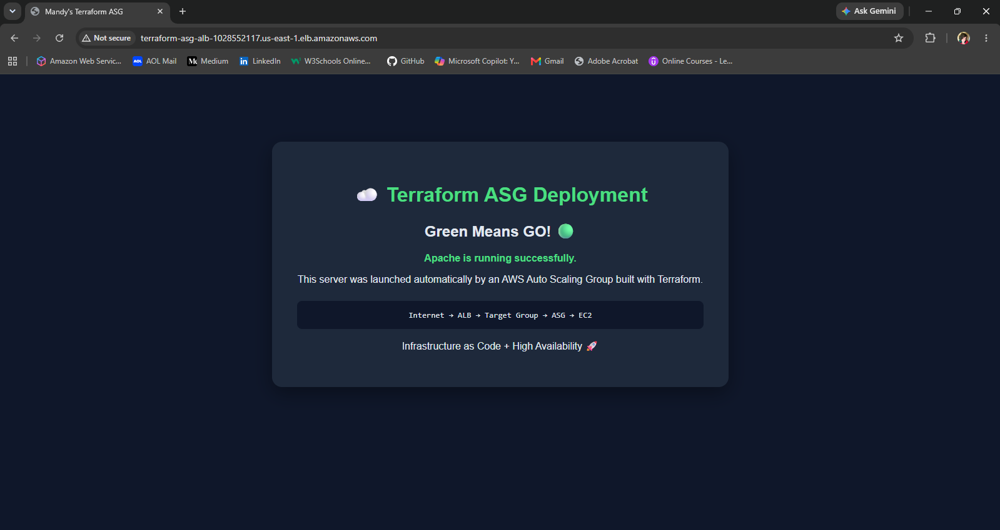
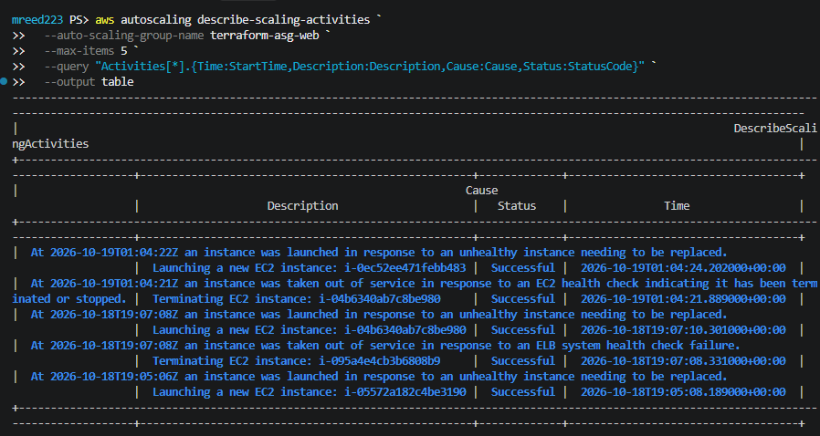
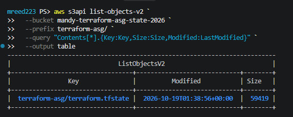
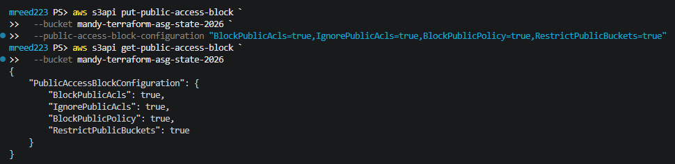
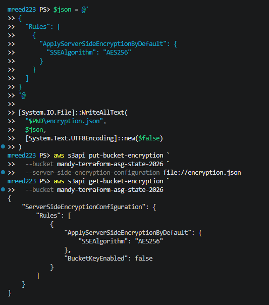
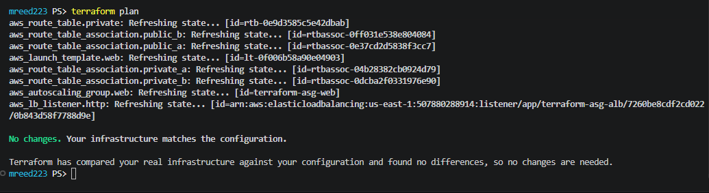

# ☁️ Terraform Auto Scaling Web Application on AWS

A highly available **application-tier AWS web architecture** built with Terraform, featuring an Application Load Balancer, Auto Scaling Group, private EC2 instances across multiple Availability Zones, secure administration through AWS Systems Manager Session Manager, and an encrypted S3 remote backend for Terraform state.

This project started as an Auto Scaling deployment and turned into something even more valuable: a real troubleshooting exercise involving failed health checks, cloud-init, user data, Launch Template versions, instance replacement, secure private-instance access, Terraform resource linkage, and remote state management.

> 🟢 **Green Means GO!**

---

## 🏗️ Architecture



### Application Traffic Flow

```text
User
  ↓
ALB DNS Name
  ↓
Application Load Balancer
  ↓
Target Group :80
  ↓
Auto Scaling Group
  ↓
EC2 Apache Web Servers
```

The Application Load Balancer spans two public subnets while the EC2 instances run in private subnets across two Availability Zones.

The EC2 instances have no direct inbound access from the internet.

---

## 🎯 Project Goals

The goal of this project was to build a production-aligned Auto Scaling architecture using Infrastructure as Code while strengthening my understanding of how Terraform resources connect to one another.

The deployment includes:

- Custom VPC
- Two Availability Zones
- Two public subnets
- Two private subnets
- Internet Gateway
- NAT Gateway
- Public and private route tables
- Application Load Balancer
- Target Group with HTTP health checks
- Auto Scaling Group
- EC2 Launch Template
- Apache web servers
- Security group-to-security group access
- IAM instance profile
- AWS Systems Manager Session Manager
- S3 remote Terraform state
- S3 state versioning
- Server-side encryption
- Public access blocking
- Terraform state locking

---

## 🧰 Technologies Used

| Technology | Purpose |
|---|---|
| Terraform | Infrastructure as Code |
| AWS VPC | Network isolation and routing |
| Amazon EC2 | Apache web servers |
| EC2 Auto Scaling | Instance health and automatic replacement |
| Application Load Balancer | Distributes incoming web traffic |
| Target Groups | Routes traffic and performs health checks |
| IAM | EC2 instance permissions |
| AWS Systems Manager | Secure EC2 administration without SSH |
| Amazon S3 | Remote Terraform state |
| Amazon Linux 2023 | EC2 operating system |
| Apache HTTP Server | Web application |
| AWS CLI | Deployment verification and troubleshooting |
| PowerShell | Local CLI environment |

---

# 🌐 Network Design

The custom VPC uses:

```text
10.0.0.0/16
```

and spans two Availability Zones in `us-east-1`.

| Subnet | CIDR | Purpose |
|---|---|---|
| Public Subnet 1 | `10.0.1.0/24` | ALB + NAT Gateway |
| Public Subnet 2 | `10.0.2.0/24` | ALB |
| Private Subnet 1 | `10.0.11.0/24` | ASG EC2 instances |
| Private Subnet 2 | `10.0.12.0/24` | ASG EC2 instances |

### Public Traffic

The public subnets use a route to the Internet Gateway:

```text
0.0.0.0/0
      ↓
Internet Gateway
```

The internet-facing Application Load Balancer spans both public subnets.

### Private Instance Outbound Traffic

The EC2 instances do not receive public IP addresses.

A NAT Gateway in Public Subnet 1 provides outbound internet access for both private subnets:

```text
Private EC2
     ↓
Private Route Table
     ↓
NAT Gateway
     ↓
Public Subnet 1
     ↓
Internet Gateway
     ↓
Internet
```

This allows the private instances to install packages and reach external services without exposing them directly to inbound internet traffic.

---

# ⚖️ Architecture Tradeoff: Single NAT Gateway

This project uses **one NAT Gateway in Public Subnet 1** to provide outbound internet access for instances in both private subnets.

For a learning environment, this design reduces cost while still allowing me to practice private subnet routing and NAT-based outbound connectivity.

There is an important availability tradeoff, however.

Although the **application tier** is distributed across two Availability Zones, the single NAT Gateway creates a single-AZ dependency for private-subnet outbound internet connectivity.

```text
Private Subnet 1 ─┐
                  ├──→ NAT Gateway in AZ 1 ──→ Internet
Private Subnet 2 ─┘
```

For a production architecture requiring stronger multi-AZ resilience, I would deploy **one NAT Gateway per Availability Zone** and route each private subnet through the NAT Gateway in its own AZ.

```text
Private Subnet AZ 1
        ↓
NAT Gateway AZ 1
        ↓
Internet

Private Subnet AZ 2
        ↓
NAT Gateway AZ 2
        ↓
Internet
```

This would remove the cross-AZ NAT dependency and improve outbound-path resilience at the cost of an additional NAT Gateway.

Understanding that tradeoff was an important part of treating this as more than simply a lab deployment.

---

# 🔐 Security Design

The architecture separates public application access from the EC2 layer using two security groups.

## Application Load Balancer Security Group

```text
Inbound:
TCP 80
Source: 0.0.0.0/0

Outbound:
All traffic
```

## EC2 Security Group

```text
Inbound:
TCP 80
Source: ALB Security Group

Outbound:
All traffic
```

Instead of allowing EC2 port 80 from the entire internet, the EC2 security group references the ALB security group.

The resulting path is:

```text
Internet
   ↓
ALB Security Group
   ↓
Application Load Balancer
   ↓
EC2 Security Group
   ↓
Apache
```

Only web traffic coming through the load balancer can reach Apache on the private instances.

Administrative access does not require opening SSH port 22. AWS Systems Manager Session Manager provides secure access through the EC2 IAM instance profile.

---

# 🔗 Terraform Resource Linkage

One of my main goals with this project was strengthening my understanding of how Terraform resources pass values to one another.

For example:

```hcl
resource "aws_security_group" "ec2" {
  vpc_id = aws_vpc.main.id
}
```

Terraform creates:

```text
aws_vpc.main
```

AWS assigns the VPC an actual ID:

```text
vpc-xxxxxxxx
```

Terraform exposes that value through:

```hcl
aws_vpc.main.id
```

and passes it into the security group.

This same **resource → attribute → consumer** pattern connects the architecture together.

### VPC → Subnets

```hcl
vpc_id = aws_vpc.main.id
```

### VPC → Security Groups

```hcl
vpc_id = aws_vpc.main.id
```

### NAT Gateway → Public Subnet

```hcl
subnet_id = aws_subnet.public_a.id
```

### Private Route → NAT Gateway

```hcl
nat_gateway_id = aws_nat_gateway.main.id
```

### EC2 Security Group → ALB Security Group

```hcl
security_groups = [aws_security_group.alb.id]
```

### ALB → Public Subnets

```hcl
subnets = [
  aws_subnet.public_a.id,
  aws_subnet.public_b.id
]
```

### Target Group → VPC

```hcl
vpc_id = aws_vpc.main.id
```

### Listener → ALB

```hcl
load_balancer_arn = aws_lb.web.arn
```

### Listener → Target Group

```hcl
target_group_arn = aws_lb_target_group.web.arn
```

### Auto Scaling Group → Private Subnets

```hcl
vpc_zone_identifier = [
  aws_subnet.private_a.id,
  aws_subnet.private_b.id
]
```

### Auto Scaling Group → Target Group

```hcl
target_group_arns = [
  aws_lb_target_group.web.arn
]
```

### Auto Scaling Group → Launch Template

```hcl
launch_template {
  id      = aws_launch_template.web.id
  version = "$Latest"
}
```

### Launch Template → EC2 Security Group

```hcl
vpc_security_group_ids = [
  aws_security_group.ec2.id
]
```

### IAM Role → Instance Profile

```hcl
role = aws_iam_role.ec2_ssm.name
```

### Instance Profile → Launch Template

```hcl
iam_instance_profile {
  name = aws_iam_instance_profile.ec2_ssm.name
}
```

These references do more than pass values. They also create **implicit dependencies**, allowing Terraform to determine much of the correct resource creation order automatically.

---

# 🚀 Launch Template & Auto Scaling

The EC2 configuration is defined through an AWS Launch Template.

The template specifies:

- Amazon Linux 2023
- `t3.micro`
- EC2 security group
- IAM instance profile
- Apache bootstrap script

The Auto Scaling Group uses:

```text
Minimum: 2
Desired: 2
Maximum: 5
```

and launches instances across both private subnets.



This maintains two instances during normal operation while allowing the group to scale as high as five instances.

---

# 📜 Bootstrapping Apache with User Data

The final configuration keeps the operating system bootstrap logic in a separate file:

```text
user_data.sh
```

The Launch Template loads the script using:

```hcl
user_data = base64encode(file("${path.module}/user_data.sh"))
```

The script:

1. Updates the operating system packages
2. Installs Apache
3. Enables Apache at boot
4. Starts the Apache service
5. Creates the project landing page

Separating the bootstrap script from `main.tf` keeps the Terraform configuration cleaner and makes the user data easier to inspect and troubleshoot.

---

# 🔎 Troubleshooting Story

This became one of the most valuable parts of the project.

After the initial deployment, Terraform completed successfully and the Auto Scaling Group launched EC2 instances.

But the Application Load Balancer Target Group reported:

```text
unhealthy
Target.FailedHealthChecks
```

Terraform had successfully created the infrastructure, but something in the application path wasn't working.

Rather than immediately changing resources, I followed the request path layer by layer.

---

## 1️⃣ Follow the Request Path

The expected path was:

```text
Browser
   ↓
Application Load Balancer
   ↓
ALB Security Group
   ↓
Target Group
   ↓
EC2 Security Group
   ↓
Apache
```

The EC2 security group correctly allowed TCP port 80 from the ALB security group.

The instances were also being launched into the expected private subnets.

That eliminated several possible causes.

---

## 2️⃣ Verify the Outbound Network Path

Because the instances needed outbound internet access to install Apache, I verified:

```text
Private Subnet
      ↓
Private Route Table
      ↓
NAT Gateway
      ↓
Public Subnet
      ↓
Internet Gateway
      ↓
Internet
```

The NAT Gateway was available.

The private route table contained:

```text
0.0.0.0/0
      ↓
NAT Gateway
```

and the public route table contained:

```text
0.0.0.0/0
      ↓
Internet Gateway
```

The outbound network path was structurally correct.

That pushed the investigation toward the instance bootstrap process.

---

## 3️⃣ Auto Scaling Was Actually Working

While troubleshooting, the Auto Scaling Group began replacing instances because the ELB health checks continued to fail.

AWS activity showed instances being terminated because of failed ELB health checks and replacement instances being launched.

This revealed an important distinction:

> **Auto Scaling itself wasn't broken. It was correctly reacting to unhealthy instances.**

But every replacement instance received the same Launch Template configuration.

That meant the same failure kept repeating:

```text
Launch instance
      ↓
Application unhealthy
      ↓
ELB health check fails
      ↓
ASG terminates instance
      ↓
ASG launches replacement
      ↓
Replacement receives same configuration
      ↓
Failure repeats
```

**Replacing infrastructure does not fix a bad launch configuration.**

---

## 4️⃣ Add Secure Diagnostic Access with Systems Manager

The EC2 instances were intentionally deployed in private subnets without SSH access.

Rather than opening port 22, I added AWS Systems Manager access through Terraform.

The relationship became:

```text
IAM Role
   ↓
AmazonSSMManagedInstanceCore
   ↓
IAM Instance Profile
   ↓
Launch Template
   ↓
EC2
   ↓
Systems Manager Session Manager
```

The Launch Template receives the instance profile through:

```hcl
iam_instance_profile {
  name = aws_iam_instance_profile.ec2_ssm.name
}
```

This allowed me to connect securely to the private instances without:

```text
Public IP       ❌
Inbound SSH     ❌
SSH key pair    ❌
```

Once connected through Session Manager, I checked Apache:

```bash
sudo systemctl status httpd --no-pager
```

The result was:

```text
Unit httpd.service could not be found.
```

That was an important clue.

Apache wasn't merely stopped.

**Apache had never been installed.**

---

## 5️⃣ Follow the Evidence into cloud-init

Next I inspected the cloud-init logs.

They showed:

```text
Failed to run module scripts-user
```

That moved the investigation directly to EC2 user data.

I inspected the actual script received by the instance:

```bash
sudo head -5 /var/lib/cloud/instance/scripts/part-001 | cat -A
```

The output revealed whitespace before the shebang:

```text
 #!/bin/bash
    dnf update -y
    dnf install -y httpd
```

The script needed to begin directly with:

```bash
#!/bin/bash
```

The malformed script explained the entire failure chain:

```text
User data fails
      ↓
Apache never installs
      ↓
Nothing listens on port 80
      ↓
ALB health check fails
      ↓
Instance becomes unhealthy
      ↓
ASG replaces instance
      ↓
Replacement receives same broken user data
      ↓
Cycle repeats
```

We had reached the root cause. 🎯

---

# 🛠️ Fixing the Root Cause

Instead of continuing to embed the script inside the Terraform heredoc, I moved the bootstrap logic into a standalone file:

```text
user_data.sh
```

The file begins correctly with:

```bash
#!/bin/bash
```

Terraform now reads it using:

```hcl
user_data = base64encode(file("${path.module}/user_data.sh"))
```

Updating the Launch Template created **Launch Template version 3**.

But creating a new Launch Template version alone does not automatically mean every existing EC2 instance is replaced.

I therefore initiated an **Auto Scaling Instance Refresh**.

The refresh gradually replaced the existing instances with instances launched from version 3 of the template.



After the refresh completed, the Auto Scaling Group showed two healthy `InService` instances running Launch Template version 3.

The Target Group then reported both instances as:

```text
healthy
```



And the application finally loaded successfully through the ALB DNS name.



## 🟢 Green Means GO!

---

# ♻️ Testing Auto Scaling Self-Healing

Getting the application healthy wasn't the end of the test.

I intentionally terminated one of the healthy EC2 instances to verify that the Auto Scaling Group could maintain desired capacity without manual intervention.

The expected behavior was:

```text
Desired Capacity = 2

One instance terminated
        ↓
Actual Capacity = 1
        ↓
ASG detects capacity mismatch
        ↓
Replacement EC2 launched
        ↓
Replacement enters InService
        ↓
ALB health checks pass
        ↓
Healthy Capacity = 2
```

During the test, the original instance transitioned to `Terminating` while the replacement instance entered `Pending`.

AWS scaling activity confirmed that a replacement EC2 instance had been launched.



The replacement eventually registered as healthy in the Target Group.


The test demonstrated that the architecture wasn't simply running two EC2 instances.

**The Auto Scaling Group was actively maintaining the desired state of the application infrastructure.**

---

# 🔐 Terraform Remote State

The project initially used local Terraform state:

```text
Terraform
    ↓
terraform.tfstate
    ↓
AWS
```

For a more production-aligned configuration, I migrated the state to an Amazon S3 backend:

```text
Terraform
    ↓
S3 Remote Backend
    ↓
terraform-asg/terraform.tfstate
    ↓
AWS
```

The dedicated state bucket is:

```text
mandy-terraform-asg-state-2026
```

with the state stored at:

```text
terraform-asg/terraform.tfstate
```



---

## 🪣 Backend Configuration

The Terraform backend is configured in `providers.tf`:

```hcl
backend "s3" {
  bucket       = "mandy-terraform-asg-state-2026"
  key          = "terraform-asg/terraform.tfstate"
  region       = "us-east-1"
  encrypt      = true
  use_lockfile = true
}
```

The existing local state was migrated using:

```bash
terraform init -migrate-state
```

The state object was then verified in S3.

---

# 🔒 Protecting Terraform State

Terraform state contains detailed information about managed infrastructure and can potentially contain sensitive values.

Before migrating the state, I configured several protections on the S3 bucket.

## Public Access Block

All four S3 public access settings were enabled:

```text
BlockPublicAcls       = true
IgnorePublicAcls      = true
BlockPublicPolicy     = true
RestrictPublicBuckets = true
```



## Server-Side Encryption

The bucket uses S3 server-side encryption:

```text
AES256
```



## Versioning

S3 versioning is enabled.

This allows previous versions of the Terraform state object to be retained, providing additional recovery protection if the state object is accidentally overwritten or corrupted.

## State Locking

The S3 backend uses:

```hcl
use_lockfile = true
```

State locking helps prevent multiple Terraform operations from modifying the same state simultaneously.

This becomes especially important when Infrastructure as Code is managed collaboratively.

---

# ✅ Final Terraform Validation

After migrating the state to S3, I ran:

```bash
terraform plan
```

Terraform:

1. Read the remote state from S3
2. Refreshed the real AWS resources
3. Compared the infrastructure against the Terraform configuration
4. Found no drift

The result:

```text
No changes. Your infrastructure matches the configuration.
```



That confirmed:

```text
Terraform configuration
        ↓
S3 remote state
        ↓
Real AWS infrastructure
        ↓
No differences
        ↓
🟢 GMG
```

---

# 📁 Repository Structure

```text
terraform-asg-deployment/
│
├── main.tf
├── providers.tf
├── variables.tf
├── outputs.tf
├── terraform.tfvars.example
├── user_data.sh
├── .terraform.lock.hcl
├── .gitignore
├── README.md
│
└── screenshots/
    ├── 00-terraform-asg-architecture-diagram.png
    ├── 01-terraform-asg-application-success.png
    ├── 02-asg-healthy-multi-az-instances.png
    ├── 03-launch-template-v3-instance-refresh-success.png
    ├── 04-alb-targets-healthy-after-self-healing.png
    ├── 05-asg-self-healing-scaling-activities.png
    ├── 06-s3-remote-terraform-state.png
    ├── 07-terraform-plan-no-changes.png
    ├── 08-s3-public-access-blocked.png
    └── 09-s3-state-encryption-aes256.png
```

Terraform state, local variable values, plan files, and the `.terraform` directory are intentionally excluded from source control.

---

# 🧠 What I Learned

This project reinforced much more than simply creating AWS resources with Terraform.

### Terraform

- Resource references connect infrastructure together
- Terraform attributes pass values between resources
- References create implicit dependencies
- Launch Template changes can create new versions without automatically replacing existing instances
- Instance Refresh can roll updated Launch Template configurations through an Auto Scaling Group
- Remote state separates Terraform state from the local workstation
- State locking helps protect shared infrastructure workflows

### AWS Networking

- Public and private subnets serve different purposes
- Internet Gateways provide internet connectivity for public subnet routing
- NAT Gateways provide outbound connectivity for private instances
- A single NAT Gateway can reduce cost but creates an availability tradeoff
- Multi-AZ design must be evaluated across the entire dependency path, not just the EC2 layer

### Security

- Private EC2 instances do not need public IP addresses
- EC2 security groups can trust the ALB security group instead of the entire internet
- Systems Manager Session Manager allows private-instance administration without inbound SSH
- IAM roles and instance profiles provide AWS permissions to EC2 instances
- Terraform state should be protected because it can contain infrastructure details and sensitive values

### Auto Scaling

- Desired capacity represents the state AWS should maintain
- Auto Scaling can replace unhealthy or terminated instances automatically
- A healthy ASG does not necessarily mean the application itself is healthy
- Replacing instances will reproduce a broken configuration if the Launch Template itself is the problem

### Troubleshooting

The biggest lesson was to follow the request path and let the evidence narrow the problem:

```text
ALB unhealthy
    ↓
Check SG path
    ↓
Check subnet placement
    ↓
Check NAT and routes
    ↓
Check instance
    ↓
Apache missing
    ↓
Check cloud-init
    ↓
scripts-user failed
    ↓
Inspect actual user data
    ↓
Find malformed script
    ↓
Fix root cause
```

Instead of randomly changing infrastructure, I worked through the architecture layer by layer until the failure pointed to the actual root cause.

---

# 🏁 Final Result

The completed project demonstrates:

- ✅ Terraform Infrastructure as Code
- ✅ Custom AWS VPC
- ✅ Multi-AZ application architecture
- ✅ Public Application Load Balancer
- ✅ Private EC2 instances
- ✅ Security group-to-security group access
- ✅ Auto Scaling across two Availability Zones
- ✅ Application health checks
- ✅ Auto Scaling self-healing
- ✅ Launch Template versioning
- ✅ Auto Scaling Instance Refresh
- ✅ Secure Systems Manager access
- ✅ No inbound SSH requirement
- ✅ Apache bootstrap automation
- ✅ S3 remote Terraform state
- ✅ S3 versioning
- ✅ Server-side encryption
- ✅ Public access blocking
- ✅ Terraform state locking
- ✅ Root-cause troubleshooting
- ✅ Infrastructure validation with `terraform plan`

The infrastructure was not considered complete simply because `terraform apply` succeeded.

It was complete when I could **build it, explain how the resources connected, break it intentionally, troubleshoot a real failure, fix the root cause, test self-healing, and validate the final state.**

## 🟢 Green Means GO!